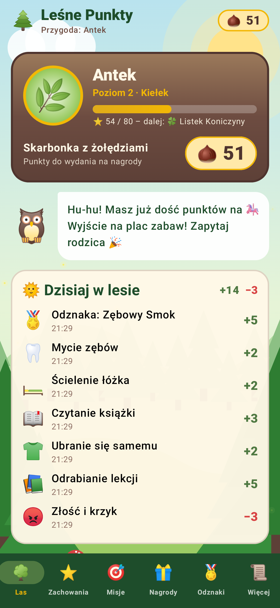
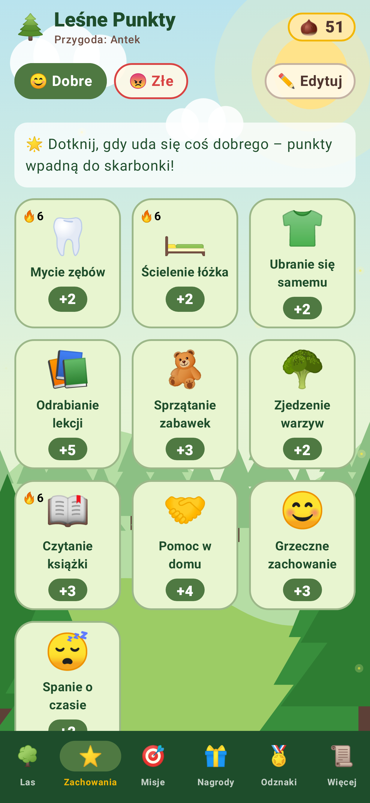
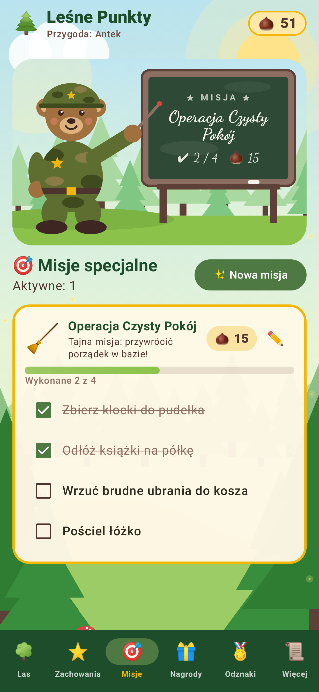
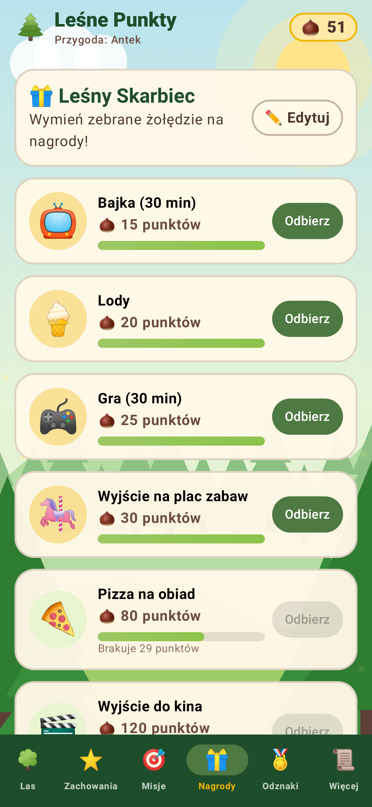
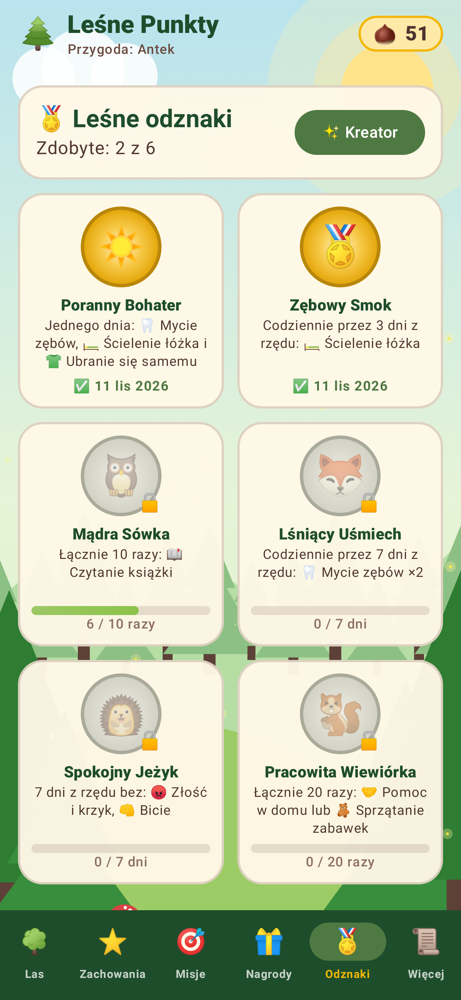

# 🌲 Leśne Punkty

Aplikacja na Androida w klimacie bajkowego lasu. Dziecko zbiera punkty (🌰 żołędzie) za dobre zachowanie, wymienia je na nagrody, zdobywa poziomy i odznaki, a za złe zachowanie traci punkty.

<p>
  
 
</p>

## Co potrafi

- **Zachowania** – dobre i złe, każde z ikonką (zestaw ponad 60 emoji albo własne emoji), punktami i licznikiem serii 🔥. Jedno dotknięcie przyznaje lub odejmuje punkty; pomyłkę można cofnąć z paska na dole ekranu albo z historii.
- **Misje** – jednorazowe misje z podpunktami do odhaczania (np. „Operacja Czysty Pokój”). Po wykonaniu wszystkich dziecko dostaje punkty. Na górze zakładki Miś Kapral w mundurze moro pokazuje misję na leśnej tablicy.
- **Nagrody** – Leśny Skarbiec z cenami, paskiem postępu i potwierdzeniem odbioru.
- **Poziomy** – 12 leśnych poziomów od 🌱 Nasionka do 👑 Króla Lasu. Liczą się zdobyte punkty, więc odbieranie nagród nie cofa poziomu.
- **Kreator odznak** – cztery rodzaje warunków:
  - 🎯 **Combo dnia** – kilka zachowań tego samego dnia (z liczbą powtórzeń każdego),
  - 🔥 **Seria dni** – zachowania codziennie przez N dni z rzędu,
  - 🧮 **Licznik** – zachowania łącznie N razy,
  - 🛡️ **Bez wpadki** – N dni z rzędu bez wybranych złych zachowań.

  Za odznakę można ustawić bonusowe punkty.
- **Wspólne punkty na kilku telefonach** – bez kont: pierwszy telefon tworzy *kod rodziny* (np. `K7QM2-XP4RA`), drugi go wpisuje i od tej pory punkty, nagrody, odznaki i ustawienia synchronizują się przez internet. Bez internetu wszystko działa dalej, a zmiany wysyłają się po odzyskaniu połączenia.
- **PIN rodzica** (opcjonalny) – blokuje przyznawanie punktów, odbieranie nagród i edycję. Aplikacja sama blokuje się po wyjściu z niej.
- Wszystkie dane są zapisywane lokalnie na telefonie (`data.json`, objęte kopią zapasową Androida).

## Włączenie wspólnych punktów (Firebase, jednorazowo, za darmo)

Synchronizacja używa darmowego planu Firebase Realtime Database. Bez konfiguracji aplikacja działa normalnie, tylko bez tej funkcji.

1. Wejdź na https://console.firebase.google.com → **Dodaj projekt** (np. „lesne-punkty”). Google Analytics możesz wyłączyć.
2. **Build → Realtime Database → Utwórz bazę danych**. Wybierz lokalizację (np. `europe-west1`) i **tryb zablokowany**.
3. W zakładce **Reguły** wklej zawartość pliku [`database.rules.json`](database.rules.json) i kliknij **Opublikuj**. Reguły pozwalają czytać i zapisywać tylko pod konkretnym 10-znakowym kodem rodziny, a listowanie wszystkich rodzin jest zablokowane.
4. **Ustawienia projektu (⚙️) → Twoje aplikacje → Android**. Nazwa pakietu: `pl.antek.punkty`. Pobierz plik **`google-services.json`**.
5. Umieść plik w `app/google-services.json` i zbuduj aplikację. W GitHub Actions możesz zamiast tego dodać sekret repozytorium `GOOGLE_SERVICES_JSON` z zawartością pliku.

Kod rodziny pełni rolę hasła: kto go zna, widzi punkty rodziny. Ma 10 losowych znaków (ok. 10^15 kombinacji), więc nie da się go zgadnąć.

## Budowanie

```bash
./gradlew assembleRelease   # APK: app/build/outputs/apk/release/app-release.apk
```

Wymaga JDK 17+ i Android SDK (platforma 35). Testy (`./gradlew testDebugUnitTest`) sprawdzają logikę odznak i poziomów, przechodzą przez kreator odznak oraz odświeżają zrzuty ekranu w `screenshots/`. GitHub Actions buduje APK przy każdym pushu (zakładka *Actions* → artefakt `lesne-punkty-apk`).

> APK jest podpisywany kluczem debug. Aktualizacja z innego komputera (inny klucz) wymaga odinstalowania poprzedniej wersji, co usuwa dane.
